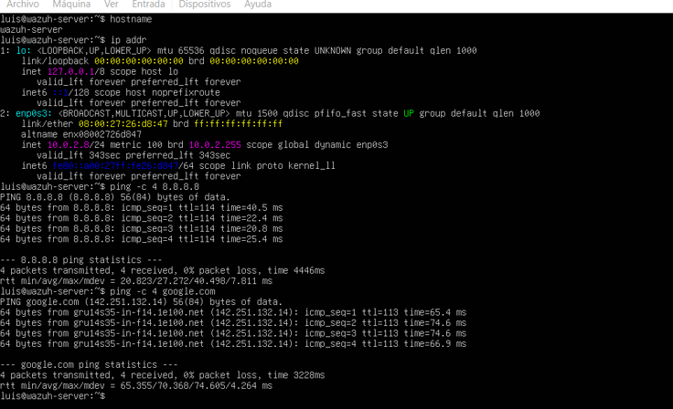
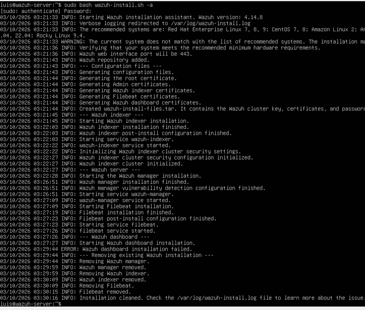
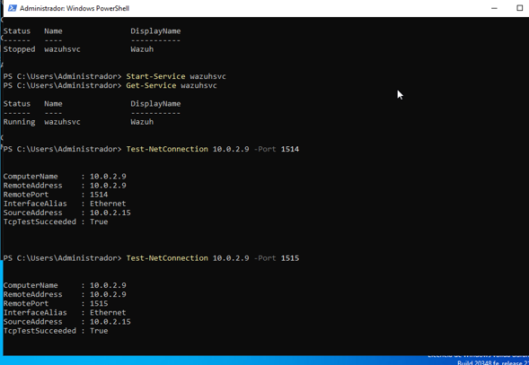
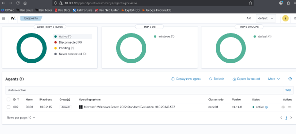
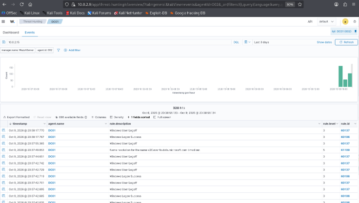
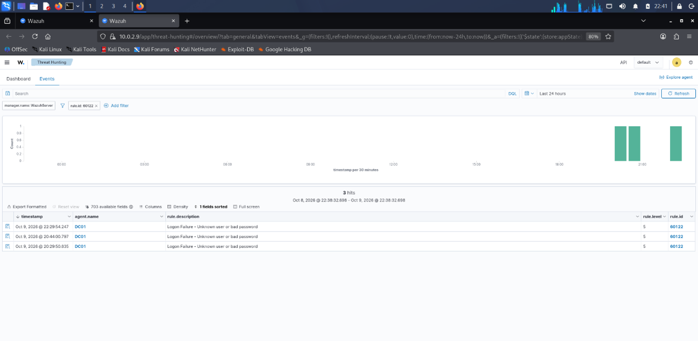
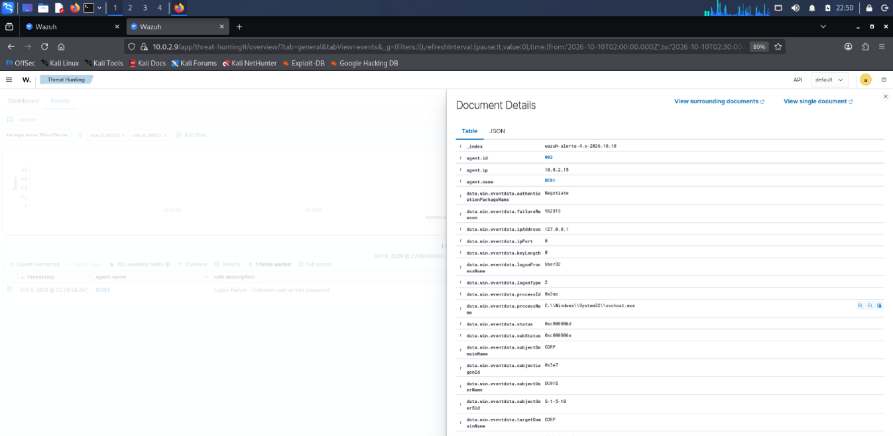
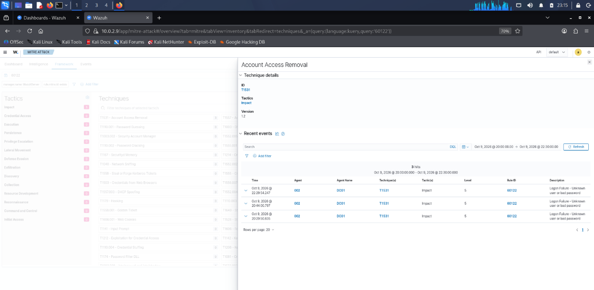
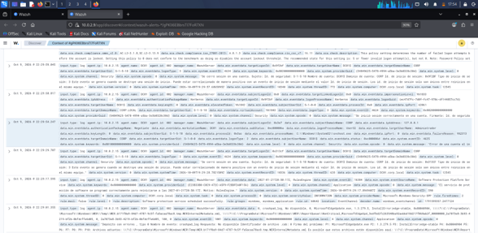
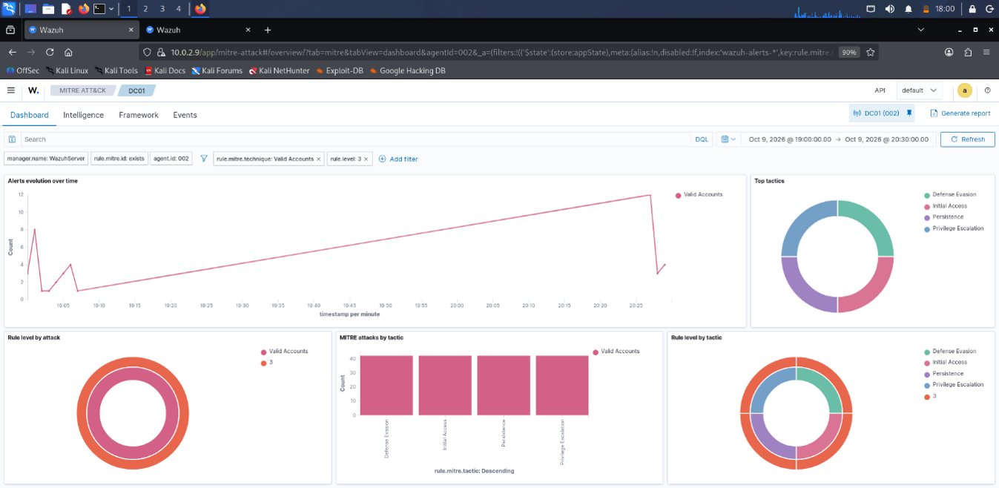

# Laboratorio 11 — Wazuh SIEM y operaciones Blue Team

> **Área:** Ciberseguridad defensiva · SIEM · Monitorización de endpoints · Análisis de eventos  
> **Entorno:** laboratorio virtualizado en Oracle VirtualBox  
> **Propósito:** documentar la recepción, consulta e investigación de eventos de seguridad mediante Wazuh.

## Tabla de contenido

1. [Descripción general](#1-descripción-general)
2. [Objetivos](#2-objetivos)
3. [Arquitectura del laboratorio](#3-arquitectura-del-laboratorio)
4. [Herramientas y tecnologías](#4-herramientas-y-tecnologías)
5. [Desarrollo y evidencias](#5-desarrollo-y-evidencias)
   - [Figura 1. Validación de la red](#figura-1-validación-de-la-red-del-laboratorio)
   - [Figura 2. Wazuh Dashboard](#figura-2-wazuh-dashboard)
   - [Figura 3. Instalación del agente](#figura-3-instalación-y-configuración-del-agente-windows)
   - [Figura 4. Agente conectado](#figura-4-estado-del-agente-conectado)
   - [Figura 5. Eventos de Windows](#figura-5-eventos-de-seguridad-de-windows)
   - [Figura 6. Alerta de autenticación fallida](#figura-6-alerta-de-autenticación-fallida)
   - [Figura 7. Investigación de la alerta](#figura-7-investigación-de-la-alerta)
   - [Figura 8. Referencia MITRE ATT&CK](#figura-8-análisis-de-la-referencia-mitre-attck)
   - [Figura 9. Investigación de incidentes](#figura-9-revisión-de-eventos-para-la-investigación-de-incidentes)
   - [Figura 10. Hallazgos de seguridad](#figura-10-hallazgos-de-seguridad-y-evaluación-de-configuración)
6. [Procedimiento realizado](#6-procedimiento-realizado)
7. [Análisis técnico de la alerta](#7-análisis-técnico-de-la-alerta)
8. [Resultados observados](#8-resultados-observados)
9. [Hallazgos y recomendaciones](#9-hallazgos-y-recomendaciones)
10. [Limitaciones y alcance](#10-limitaciones-y-alcance)
11. [Estructura del directorio](#11-estructura-del-directorio)
12. [Referencias](#12-referencias)
13. [Conclusión](#13-conclusión)

---

## 1. Descripción general

Este laboratorio implementa un entorno de monitorización defensiva utilizando **Wazuh**, una plataforma que permite centralizar y analizar eventos de endpoints, detectar actividad relevante y apoyar la investigación de alertas.

La práctica integra un servidor Wazuh desplegado sobre Ubuntu Server y un endpoint Windows Server 2022 identificado como `DC01`. Desde la estación de análisis Kali Linux se accede al dashboard para comprobar el estado del agente, consultar eventos de seguridad, investigar una alerta de autenticación fallida y revisar los resultados de evaluación de configuración de seguridad.

Las capturas de pantalla se almacenan en la carpeta `images/` de este directorio. Los enlaces del documento usan rutas relativas para que las figuras se visualicen correctamente en GitHub.

## 2. Objetivos

- Implementar un entorno básico de monitorización con Wazuh.
- Verificar la conectividad entre el servidor SIEM y el endpoint Windows.
- Comprobar el estado operativo del agente Wazuh.
- Consultar eventos de seguridad recibidos desde Windows.
- Investigar una alerta de autenticación fallida.
- Revisar los datos del evento y su contexto antes de extraer conclusiones.
- Consultar los resultados de Security Configuration Assessment (SCA).
- Documentar hallazgos, limitaciones y recomendaciones de mejora.

## 3. Arquitectura del laboratorio

| Componente | Sistema operativo / función | Dirección IP |
|---|---|---|
| Estación de análisis | Kali Linux 2025.4 | `10.0.2.6` |
| Servidor SIEM | Ubuntu Server 24.04 LTS | `10.0.2.9` |
| Endpoint monitorizado | Windows Server 2022 Standard Evaluation (`DC01`) | `10.0.2.15` |

**Dashboard de Wazuh:** `https://10.0.2.9`

El servidor Ubuntu aloja los componentes de Wazuh Manager, Indexer y Dashboard. El agente instalado en Windows recopila los eventos configurados y los envía al servidor para su procesamiento y consulta.

Las direcciones IP corresponden a la red virtual utilizada durante las pruebas en Oracle VirtualBox.

## 4. Herramientas y tecnologías

- **Wazuh Manager:** procesamiento de eventos y aplicación de reglas de detección.
- **Wazuh Indexer:** indexación y almacenamiento de información.
- **Wazuh Dashboard:** visualización, búsqueda e investigación de alertas.
- **Wazuh Agent:** recopilación y envío de información desde Windows.
- **Windows Event Log:** fuente de eventos de seguridad del endpoint.
- **Security Configuration Assessment (SCA):** evaluación de la configuración frente a políticas de seguridad.
- **MITRE ATT&CK:** marco de referencia para contextualizar técnicas y comportamientos adversarios.
- **Oracle VirtualBox:** virtualización de los equipos del laboratorio.
- **Kali Linux:** estación de análisis y acceso al dashboard.

## 5. Desarrollo y evidencias

Las siguientes figuras corresponden a las evidencias del laboratorio. Los archivos deben estar ubicados en `labs/11-wazuh-blue-team/images/` y conservar exactamente los nombres indicados.

### Figura 1. Validación de la red del laboratorio



*Evidencia de las comprobaciones de conectividad realizadas en la red virtual.*

### Figura 2. Wazuh Dashboard



*Vista de la consola web de Wazuh utilizada para consultar el estado del entorno y acceder a las funciones de monitorización.*

### Figura 3. Instalación y configuración del agente Windows



*Evidencia del proceso de instalación y configuración del agente en el servidor Windows `DC01`.*

### Figura 4. Estado del agente conectado



*El dashboard permite comprobar que el agente `DC01` aparece activo en la plataforma.*

### Figura 5. Eventos de seguridad de Windows



*Consulta de eventos del endpoint recibidos por Wazuh para apoyar el análisis de actividad relevante.*

### Figura 6. Alerta de autenticación fallida



*Revisión de la alerta de la regla `60122`, descrita por Wazuh como `Logon Failure - Unknown user or bad password`.*

### Figura 7. Investigación de la alerta



*Inspección de los detalles del evento para revisar los campos de Windows, la cuenta asociada y el tipo de inicio de sesión.*

### Figura 8. Análisis de la referencia MITRE ATT&CK



*Consulta del mapeo MITRE ATT&CK presentado por la plataforma. La referencia ayuda a orientar la investigación, pero no demuestra por sí sola que una técnica adversaria se haya ejecutado.*

### Figura 9. Revisión de eventos para la investigación de incidentes



*Revisión de registros recibidos por Wazuh para apoyar el análisis y la clasificación inicial de eventos. La captura evidencia actividad registrada y consultada; no demuestra por sí sola que se haya ejecutado una acción de contención.*

### Figura 10. Hallazgos de seguridad y evaluación de configuración



*Resumen de los resultados de evaluación de configuración y hallazgos visibles en la plataforma. Los controles fallidos deben revisarse individualmente antes de definir medidas correctivas.*

## 6. Procedimiento realizado

1. Se preparó el entorno virtual y se verificó la comunicación entre los equipos.
2. Se accedió al dashboard de Wazuh desde Kali Linux.
3. Se instaló y configuró el agente Wazuh en Windows Server 2022.
4. Se comprobó la conectividad del endpoint con el servidor. Durante las validaciones se observó conectividad TCP hacia el servidor por el puerto `1514`.
5. Se verificó en el dashboard el estado del agente `DC01`.
6. Se consultaron eventos de seguridad recibidos desde Windows.
7. Se filtraron alertas relacionadas con fallos de autenticación.
8. Se inspeccionaron los detalles de un evento específico.
9. Se consultó la referencia MITRE ATT&CK asociada a la alerta.
10. Se revisaron los resultados de Security Configuration Assessment y se documentaron recomendaciones.

## 7. Análisis técnico de la alerta

Durante la investigación se identificó una alerta de Wazuh correspondiente a la regla `60122`:

`Logon Failure - Unknown user or bad password`

Entre los datos del evento revisado se encontraron los siguientes valores:

| Campo | Valor observado | Interpretación |
|---|---|---|
| Evento de Windows | `4625` | Fallo de inicio de sesión |
| Canal | `Security` | Registro de auditoría de seguridad de Windows |
| Equipo | `DC01.corp.local` | Endpoint que reporta el evento |
| Agente Wazuh | `DC01`, ID `002` | Identificador del agente en la plataforma |
| Cuenta objetivo | `CORP\Administrador` | Cuenta asociada al intento |
| Tipo de inicio de sesión | `7` | Desbloqueo de estación de trabajo |
| Dirección IP de origen | `127.0.0.1` | Dirección de loopback local |
| Estado | `0xc000006d` | Fallo de inicio de sesión |
| Subestado | `0xc000006a` | Contraseña incorrecta |

### Interpretación del evento

Los campos observados son compatibles con un intento de desbloqueo local que falló por una contraseña incorrecta. La dirección de loopback `127.0.0.1` y el tipo de inicio de sesión `7` no constituyen, por sí solos, evidencia de un ataque remoto.

El evento debe correlacionarse con otros registros, la frecuencia de los intentos y el contexto operativo antes de clasificarlo como incidente. Un fallo de autenticación no demuestra que haya ocurrido un acceso exitoso ni que el equipo haya sido comprometido.

## 8. Resultados observados

Durante las pruebas se documentaron los siguientes resultados:

- Acceso al dashboard de Wazuh desde la estación de análisis.
- Agente Windows `DC01` mostrado como activo.
- Recepción y consulta de eventos de seguridad del endpoint.
- Identificación de una alerta de autenticación fallida asociada a la regla `60122`.
- Consulta de los detalles del evento de Windows `4625`.
- Revisión de la referencia MITRE ATT&CK presentada por la plataforma.
- Consulta de resultados de evaluación SCA para Windows Server 2022.

En la captura de SCA revisada se observaron **87 controles aprobados, 270 fallidos y 2 no aplicables**, con una puntuación del **24 %**.

Estos valores representan el resultado observado en ese momento. Los controles fallidos requieren validación individual: no todos implican necesariamente una vulnerabilidad explotable o una configuración incorrecta para el propósito del servidor.

## 9. Hallazgos y recomendaciones

| Hallazgo | Consideración de seguridad | Recomendación |
|---|---|---|
| Controles SCA fallidos | Pueden representar desviaciones frente a una política de referencia | Revisar cada control, confirmar su aplicabilidad y priorizar según impacto |
| Fallos de autenticación | Pueden corresponder a errores de contraseña o a actividad que requiera investigación | Correlacionar cuenta, hora, tipo de inicio de sesión, origen y frecuencia |
| Referencia MITRE ATT&CK asociada a una regla | El mapeo no prueba que la técnica se haya ejecutado en el evento concreto | Validar la clasificación con eventos adicionales y contexto |
| Conteos agregados de vulnerabilidades | Un total de registros no equivale necesariamente al número de CVE únicas | Revisar los registros individuales, versiones afectadas y estado de cada hallazgo |
| Acciones de respuesta no documentadas | Las capturas de consulta no prueban que se haya contenido un incidente | Registrar acciones correctivas solo después de ejecutarlas y verificar su resultado |

### Prioridades de mejora

1. Revisar los controles SCA fallidos de mayor impacto y confirmar cuáles aplican al servidor `DC01`.
2. Investigar patrones de autenticación fallida mediante correlación de eventos.
3. Verificar los hallazgos de vulnerabilidades individualmente antes de cuantificarlos o asignar prioridades.
4. Documentar cada medida correctiva con fecha, responsable, resultado y evidencia de validación.
5. Repetir las comprobaciones después de aplicar cambios para evaluar si el riesgo se redujo.

## 10. Limitaciones y alcance

- Las pruebas se realizaron en un entorno virtual de laboratorio y no equivalen a una auditoría de producción.
- La detección de un fallo de autenticación no confirma un ataque exitoso.
- La referencia MITRE ATT&CK mostrada por una regla debe interpretarse con contexto.
- Los resultados SCA corresponden al estado capturado durante la práctica y pueden cambiar tras modificar el sistema o actualizar las políticas.
- Los conteos agregados de vulnerabilidades no deben interpretarse como cantidad de CVE únicas sin validar los registros individuales.
- No se afirma que se hayan bloqueado cuentas, cambiado contraseñas o contenido un ataque si no existe evidencia verificable de esas acciones.

## 11. Estructura del directorio

```text
labs/
└── 11-wazuh-blue-team/
    ├── README.md
    └── images/
        ├── 01-lab-network-validation.png
        ├── 02-wazuh-dashboard.png
        ├── 03-windows-agent-installation.png
        ├── 04-agent-connected.png
        ├── 05-windows-security-events.png
        ├── 06-authentication-alert.png
        ├── 07-alert-investigation.png
        ├── 08-mitre-attack-analysis.png
        ├── 09-incident-response.png
        └── 10-security-findings.png
```

**Importante:** GitHub distingue entre mayúsculas y minúsculas en los nombres de archivo. Los nombres de las imágenes deben coincidir exactamente con las rutas escritas en este README. Si las capturas tienen otros nombres, actualiza las rutas para que coincidan con los archivos reales.

## 12. Referencias

- [Documentación oficial de Wazuh: instalación del agente Windows](https://documentation.wazuh.com/current/installation-guide/wazuh-agent/wazuh-agent-package-windows.html)
- [Documentación oficial de Wazuh: configuración de la recopilación de registros](https://documentation.wazuh.com/current/user-manual/capabilities/log-data-collection/configuration.html)
- [Documentación oficial de Wazuh: políticas SCA disponibles](https://documentation.wazuh.com/current/user-manual/capabilities/sec-config-assessment/available-sca-policies.html)
- [Documentación oficial de Wazuh: detección de vulnerabilidades](https://documentation.wazuh.com/current/user-manual/capabilities/vulnerability-detection/how-it-works.html)
- [MITRE ATT&CK](https://attack.mitre.org/)

## 13. Conclusión

El laboratorio permitió documentar un escenario básico de monitorización defensiva con Wazuh, verificar el estado de un agente Windows y analizar eventos de seguridad recibidos desde `DC01`. La revisión de una autenticación fallida y de los resultados SCA muestra cómo una plataforma SIEM puede apoyar el triage de eventos, la evaluación de configuración y la priorización de acciones de mejora.

La práctica enfatiza el uso de evidencia verificable y la interpretación contextual de las alertas. Antes de clasificar un evento como incidente o aplicar cambios correctivos, es necesario validar su contexto, confirmar los hallazgos y registrar el resultado de las acciones realizadas.

---

**Aviso:** laboratorio realizado con fines educativos y defensivos en un entorno virtual autorizado.
