# Lab 12 --- AWS Cloud Security and Threat Detection

> **Portfolio area:** Cloud Security\
> **Platform:** Amazon Web Services (AWS)\
> **AWS Region:** South America (São Paulo) --- `sa-east-1`\
> **Evidence directory:** [`images/`](images/)

## Table of Contents

-   [Overview](#overview)
-   [Objectives](#objectives)
-   [Environment and Scope](#environment-and-scope)
-   [Security Architecture and
    Controls](#security-architecture-and-controls)
-   [Lab Methodology](#lab-methodology)
    -   [1. Cost Monitoring with AWS
        Budgets](#1-cost-monitoring-with-aws-budgets)
    -   [2. Identity and Access Management
        (IAM)](#2-identity-and-access-management-iam)
    -   [3. Amazon S3 Security](#3-amazon-s3-security)
    -   [4. AWS CloudTrail Activity
        Review](#4-aws-cloudtrail-activity-review)
    -   [5. Amazon GuardDuty Threat
        Detection](#5-amazon-guardduty-threat-detection)
    -   [6. Usage and Cost Review](#6-usage-and-cost-review)
-   [Findings and Analysis](#findings-and-analysis)
-   [Recommendations](#recommendations)
-   [Lessons Learned](#lessons-learned)
-   [Evidence Index](#evidence-index)
-   [Conclusion](#conclusion)
-   [Disclaimer](#disclaimer)

## Overview

This lab documents a practical review of selected AWS cloud-security
controls, focusing on identity and access management, Amazon S3
configuration, audit events, threat detection, and cost awareness. The
activities were performed in the AWS console in the São Paulo region
(`sa-east-1`).

The exercise combines preventive controls (IAM and S3 security
settings), auditability (CloudTrail Event history), and detective
controls (Amazon GuardDuty). A GuardDuty finding related to the use of
root credentials was observed and reviewed as a security signal
requiring investigation---not as proof of account compromise.

## Objectives

-   Review selected IAM identities, groups, policies, roles, and
    root-account security settings.
-   Verify Amazon S3 public-access restrictions and default encryption.
-   Review AWS CloudTrail management events to understand how
    console/API activity is recorded.
-   Enable and inspect Amazon GuardDuty threat-detection findings.
-   Review GuardDuty usage metrics and understand their limitations as
    evidence of cost.
-   Capture evidence suitable for a technical portfolio while protecting
    sensitive account information.
-   Identify practical security improvements and cost-control measures.

## Environment and Scope

  -----------------------------------------------------------------------
  Item                                Description
  ----------------------------------- -----------------------------------
  Cloud provider                      Amazon Web Services (AWS)

  Region                              São Paulo (`sa-east-1`)

  Services reviewed                   AWS Budgets, IAM, Amazon S3,
                                      CloudTrail, GuardDuty

  S3 bucket used in the lab           `luis-cloud-security-2026-bucket`

  Primary interface                   AWS Management Console

  Evidence location                   `images/`

  Lab type                            Controlled configuration review and
                                      security-observation exercise
  -----------------------------------------------------------------------

### Scope limitations

This was a limited review of selected configurations and findings in one
AWS region. It was not a comprehensive cloud penetration test, formal
compliance audit, or proof that the account is free from compromise.
Findings and observations are limited to the services, region, settings,
and time window examined.

## Security Architecture and Controls

The lab follows a layered-control approach:

1.  **Cost governance:** AWS Budgets helps alert the account owner when
    configured cost thresholds are reached.
2.  **Identity security:** IAM identities, group membership,
    permissions, roles, and root-account protections are reviewed.
3.  **Data protection:** S3 Block Public Access and default encryption
    are checked.
4.  **Audit trail:** CloudTrail Event history is used to review recorded
    management activity.
5.  **Threat detection:** GuardDuty analyzes supported data sources and
    surfaces findings that may require investigation.
6.  **Cost awareness:** Service usage and billing information are
    reviewed separately from security findings.

## Lab Methodology

### 1. Cost Monitoring with AWS Budgets

AWS Budgets can provide notifications when actual or forecasted costs
reach configured thresholds. For this lab, a low monthly reference
budget was used as a cost-control target.

Reference values:

  Setting                        Reference value
  ---------------------------- -----------------
  Monthly budget                        USD 5.00
  Actual-cost alert --- 50%             USD 2.50
  Actual-cost alert --- 80%             USD 4.00
  Actual-cost alert --- 100%            USD 5.00

These values are a monitoring reference and do not guarantee that total
AWS charges will remain below USD 5.00. **Budget alerts do not
automatically stop services or prevent additional charges.** Check the
corresponding evidence to confirm which budget and notifications were
actually configured.

### 2. Identity and Access Management (IAM)

The IAM review covered selected identities and permissions in the
account, including users, groups, attached policies, roles, and
root-account security settings where evidence was available.

Review checklist:

-   Inspect IAM users and their group memberships.
-   Review policies attached to relevant groups and identities.
-   Inspect available IAM roles and their intended purpose.
-   Check root-account security protections, including multi-factor
    authentication (MFA), where applicable.
-   Avoid using root credentials for routine administrative or
    application tasks.
-   Apply least privilege: grant only the permissions required for a
    task.

The review is observational. Do not infer that an identity is secure
solely because it exists or belongs to a group; evaluate the permissions
granted and whether they are necessary.

### 3. Amazon S3 Security

The bucket `luis-cloud-security-2026-bucket` was used to review selected
S3 security settings.

Controls reviewed:

-   **Block Public Access:** verify that account/bucket settings prevent
    unintended public access.
-   **Default encryption:** verify that new objects are encrypted by
    default. The lab configuration used SSE-S3 where shown in the
    evidence.
-   **Bucket permissions:** review the bucket policy and access settings
    for unintended external access.
-   **Data minimization:** avoid uploading sensitive personal,
    institutional, or account data to a portfolio bucket.

Encryption at rest and public-access blocking address different risks.
Encryption does not, by itself, prevent an authorized or misconfigured
principal from accessing an object.

### 4. AWS CloudTrail Activity Review

CloudTrail Event history was reviewed in `sa-east-1` to inspect recorded
management activity.

Procedure:

1.  Open CloudTrail in the intended AWS region.
2.  Open **Event history**.
3.  Clear filters when necessary to avoid unintentionally hiding
    relevant events.
4.  Select an event and inspect its event name, time, identity, source,
    and other available details.
5.  Compare the event with the console action that was performed, where
    possible.

CloudTrail event records support auditing and investigation, but the
presence or absence of an event must be interpreted within the selected
region, time range, event type, and configuration. Event history does
not automatically mean that all S3 object-level data activity is being
recorded; data events have separate configuration and billing
considerations.

### 5. Amazon GuardDuty Threat Detection

Amazon GuardDuty was enabled in the São Paulo region for the lab and its
findings were reviewed. The service's Usage page was also inspected.

#### Finding observed

  --------------------------------------------------------------------------
  Attribute                           Observed value
  ----------------------------------- --------------------------------------
  Finding type                        `Policy:IAMUser/RootCredentialUsage`

  Description                         The API `GetFindingsStatistics` was
                                      invoked using root credentials

  Severity                            Low

  API name                            `GetFindingsStatistics`

  Resource type                       Access key

  Resource identity type              Root

  Count shown                         17
  --------------------------------------------------------------------------

The evidence showed a low-severity finding indicating that the
`GetFindingsStatistics` API was invoked using root credentials. This is
a useful security signal because root credentials should not be used for
routine operations.

The displayed count of **17 should not be described as 17 attacks or 17
confirmed compromises**. It is a count associated with the finding as
displayed by the console. The finding alone does not establish malicious
intent or account compromise. Investigate the event context, identity,
timing, source information, and whether the activity was expected before
deciding on a response.

#### Recommended investigation steps

1.  Confirm whether the activity was expected and identify the workflow
    or principal that initiated it.
2.  Review related CloudTrail records for context and corroborating
    activity.
3.  Check root-account MFA and review account security settings.
4.  If the activity is unexpected, follow AWS incident-response
    guidance, review credentials and access, and investigate related
    activity.
5.  Redact account IDs, access key IDs, IP addresses, usernames, and
    other sensitive details from screenshots before publishing them.

#### GuardDuty usage metrics

The Usage page displayed multiple graphs with **"No data available"**
for the selected time range. This means that those graphs did not have
data available to display for that interval. It does **not** prove that
GuardDuty costs were USD 0.00, nor does it by itself indicate that
GuardDuty was misconfigured.

Usage metrics and billing information serve different purposes. Use AWS
Billing and Cost Management and the service's pricing information to
review actual charges and estimated post-trial costs. Do not report a
zero cost unless billing data supports that conclusion.

### 6. Usage and Cost Review

AWS service pricing depends on the region, enabled protection plans,
analyzed data volume, usage, and applicable free-trial or free-tier
terms. A trial or an account credit should not be treated as proof that
a service will remain free.

Before finishing the lab:

-   Review the GuardDuty Usage page and any available cost estimates.
-   Review AWS Billing and Cost Management for actual charges.
-   Check whether optional protection plans or malware-scanning features
    were enabled.
-   Disable GuardDuty in the lab region when continuous monitoring is no
    longer required.
-   Review and disable any separately enabled protection feature that
    may continue to incur charges.
-   Recheck billing after usage data has had time to appear.

Disabling GuardDuty is a consequential action: save the findings and
screenshots required for the portfolio first. Disabling the service can
remove its findings and configuration for that region. If ongoing
monitoring is required, do not disable it merely to reduce costs;
instead, review the cost implications and service configuration.

## Findings and Analysis

The lab demonstrates the value of combining preventive, auditing, and
detective controls:

-   **IAM:** access should be assigned through appropriately scoped
    identities and policies, with root credentials reserved for tasks
    that specifically require them.
-   **S3:** public-access restrictions and default encryption are
    important baseline controls, but bucket permissions still require
    review.
-   **CloudTrail:** event history provides context for investigating
    management actions.
-   **GuardDuty:** a low-severity root-credential-usage finding warrants
    contextual review and should not be automatically classified as a
    confirmed incident.
-   **Usage and billing:** empty usage graphs are not a reliable basis
    for claiming zero cost. Cost must be checked using the relevant
    billing information.

The main security observation was the GuardDuty finding
`Policy:IAMUser/RootCredentialUsage`. The appropriate response is
validation and investigation, not an unsupported claim of compromise.

## Recommendations

1.  Enable and maintain MFA for the root account and avoid using root
    credentials for routine work.
2.  Use named IAM identities or federated access for daily
    administration, and apply least privilege.
3.  Review IAM policies periodically and remove permissions that are no
    longer required.
4.  Keep S3 Block Public Access enabled unless a documented use case
    requires otherwise.
5.  Verify default encryption and review bucket policies before storing
    data.
6.  Use CloudTrail records to investigate unexpected activity and retain
    relevant audit evidence according to requirements.
7.  Investigate GuardDuty findings in context and document the
    disposition of each finding.
8.  Configure AWS Budgets and billing notifications, remembering that
    alerts do not stop resource usage.
9.  Check all enabled GuardDuty protection plans and related features
    before concluding the lab.
10. Redact sensitive account and identity information from all public
    portfolio evidence.

## Lessons Learned

-   Cloud security benefits from multiple layers of prevention, audit,
    and detection.
-   A security finding is an investigative lead, not necessarily proof
    of an attack.
-   Root credential use is worth reviewing because root access has broad
    account-level privileges.
-   Usage dashboards can have no data for a selected interval; billing
    must be checked separately.
-   Cost controls and budgets provide visibility but do not
    automatically prevent charges.
-   Screenshots must be reviewed for sensitive information before
    publication.

## Evidence Index

All screenshots are stored in the `images/` subfolder beside this `README.md`. The paths below are relative to this file. GitHub renders each image directly when the repository structure matches the example below.

```text
12-aws-cloud-security/
├── README.md
└── images/
    ├── fig01-aws-budget.png
    ├── fig02a-iam-user-group.png
    ├── fig02b-iam-group-policies.png
    ├── fig02c-iam-roles.png
    ├── fig02d-root-mfa.png
    ├── fig03-s3-public-access.png
    ├── fig04-s3-encryption.png
    ├── fig05-cloudtrail-events.png
    ├── fig06-cloudtrail-event-details.png
    ├── fig07-guardduty-status.png
    ├── fig08-guardduty-usage-cost.png
    └── fig09-guardduty-root-credential-usage.png
```

### Figure 1 — AWS Budgets

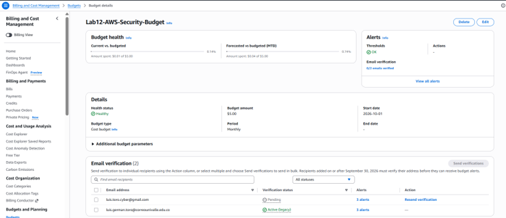

### Figure 2a — IAM user and group

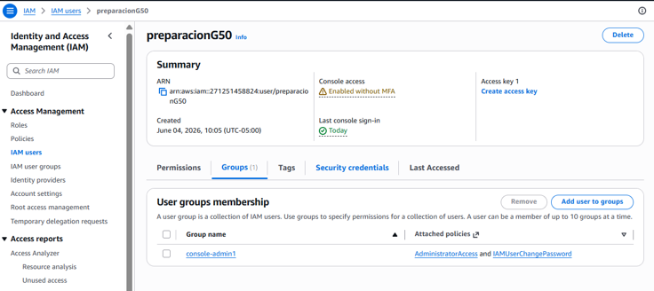

### Figure 2b — IAM group policies

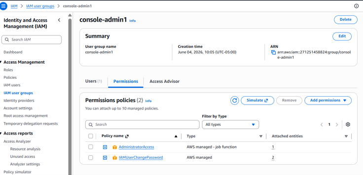

### Figure 2c — IAM roles

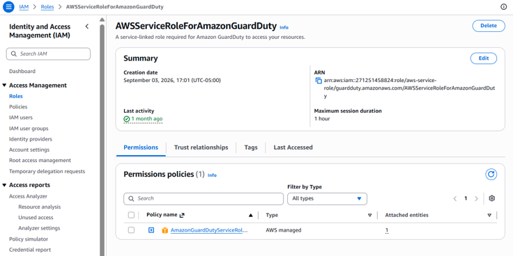

### Figure 2d — Root account MFA

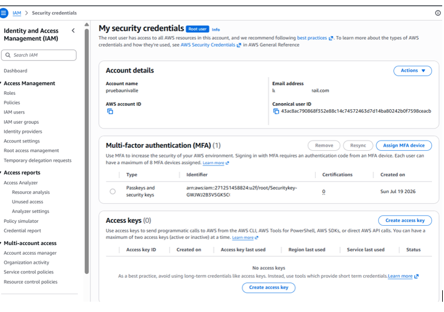

### Figure 3 — S3 public access

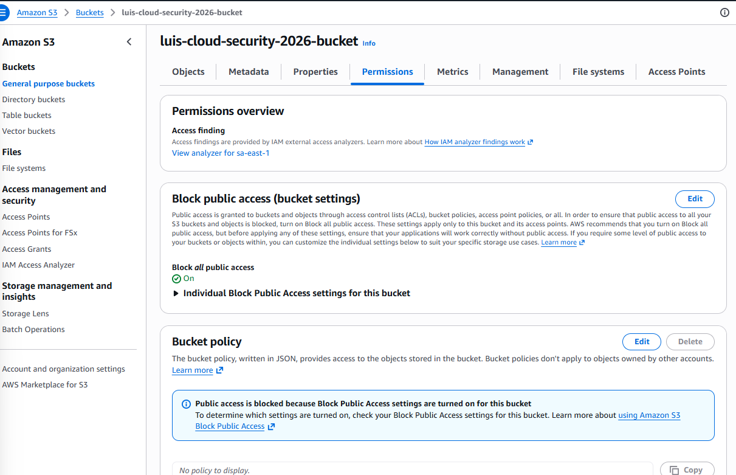

### Figure 4 — S3 encryption

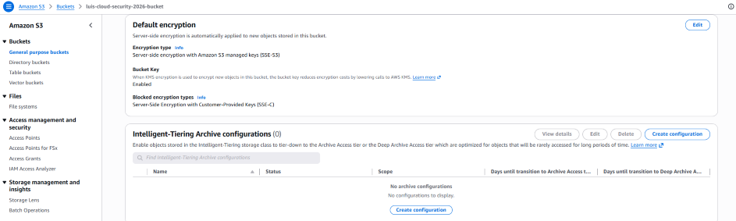

### Figure 5 — CloudTrail events

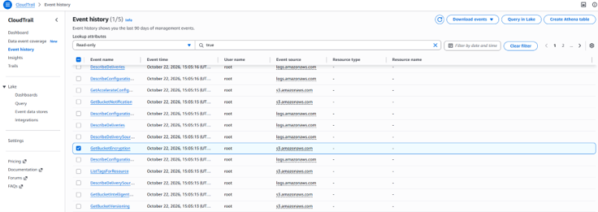

### Figure 6 — CloudTrail event details

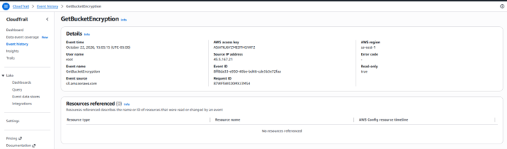

### Figure 7 — GuardDuty status

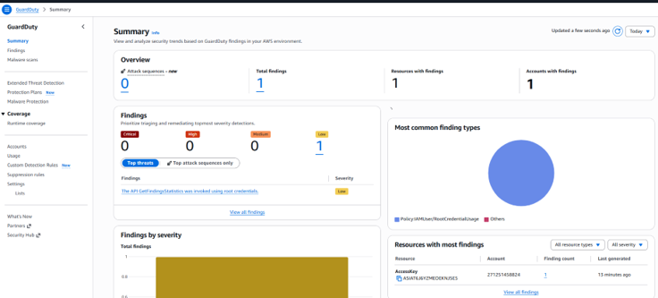

### Figure 8 — GuardDuty usage and cost metrics

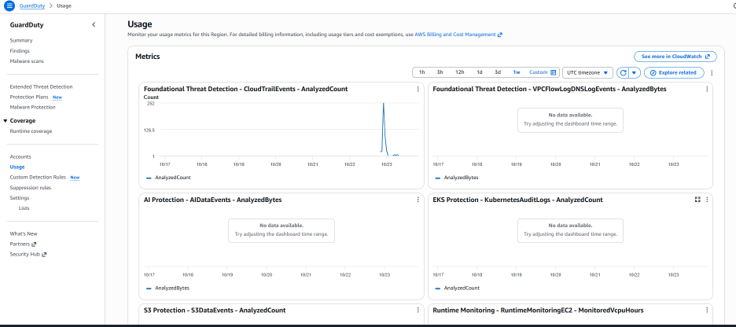

### Figure 9 — GuardDuty root credential usage finding

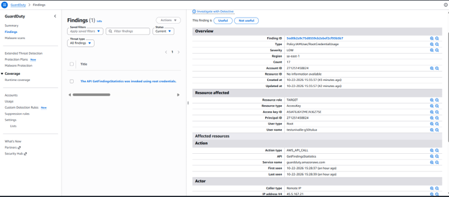

> **Evidence hygiene:** Before committing screenshots, redact account IDs, access key IDs, IP addresses, email addresses, usernames, and any other information that could expose account or personal details. Do not publish credentials, secret keys, session tokens, or other authentication material.

**Troubleshooting:** If an image does not render on GitHub, confirm that the image file has been committed and pushed, that the filename matches exactly (including uppercase/lowercase), and that `README.md` and `images/` are siblings in this lab directory. GitHub does not display a local image merely because it exists on your computer.

## Conclusion

This lab reviewed selected AWS security controls across IAM, Amazon S3,
CloudTrail, and GuardDuty, with cost monitoring considered throughout.
The observed GuardDuty finding highlighted the importance of avoiding
routine root-credential use and validating unexpected activity against
audit records.

The exercise also reinforced that an empty usage graph is not evidence
of zero cost and that budget alerts do not stop charges. Security
configuration, investigation, evidence handling, and cost review should
be treated as related parts of responsible cloud operations.

## Disclaimer

This lab was conducted for educational and portfolio purposes in an AWS
environment under the account operator's control. It is not a
comprehensive security audit, penetration test, or certification of
compliance. Service behavior, pricing, and console interfaces may
change. Confirm current AWS documentation and billing information before
making operational or cost-related decisions.
